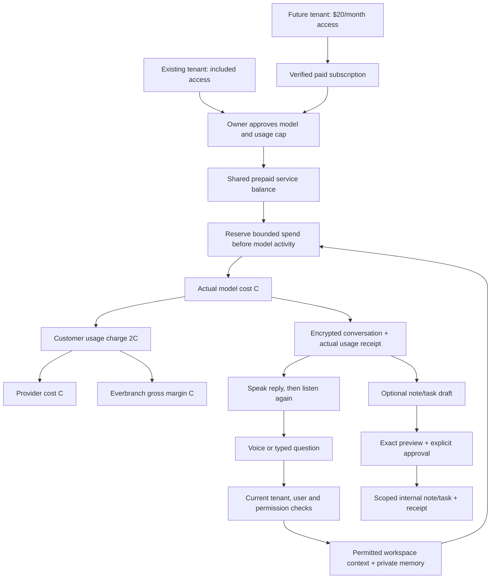

# AI Voice Branch — October 20, 2026

## Owner-approved commercial rule

Existing tenants have included AI access and pay **2× actual model cost** for
usage. Future tenants pay **$20/month access plus 2× model usage**. No setup fee
is added for this Branch. Every ordinary tenant starts **off with a $0 cap**;
the workspace owner chooses the model, approves the displayed rates and sets a
positive monthly customer spending cap before use. The cap excludes the fixed
access subscription. No automatic top-up, model upgrade or customer charge occurs
from this rollout.

The 2× rule and selectable-model/shared-prepaid design were already approved on
October 18. Source documentation was located in
`docs/retail/USAGE_PRICING_STRATEGY.md` and
`docs/operations/standard-everbranch-offer.md` on the separate retail showroom
branch (pricing checkpoint `df9eb9cec323827c5b54ae39a532c5c0b1640540`). Do not merge
that branch wholesale or overwrite its current tablet demo. The October 20 owner
instructions supersede its earlier no-future-AI-access-fee statement; the other
service rates, accepted agreements and existing subscriptions remain separate.

For $1 of verified model cost, customer usage is $2: $1 covers the provider and
$1 is Everbranch gross margin before payment fees, support and other expenses.
Memory has no additional access subscription; retrieved memory and conversation
history contribute to the model's measured input usage. Browser speech recognition
and playback in this increment do not dispatch OpenAI audio or telephone APIs.

## Access and fixed existing-tenant boundary

`config/ai_branch.php` pins the exact fourteen existing production tenant ID/slug
pairs reviewed by the owner. The separately audited fictional pilot is tenant 14.
New tenant creation cannot inherit those grants, including on a repeated rollout.
`ai-branch:include-existing` previews; `--apply --authorization=REFERENCE` records
canonical included module entitlements and creates missing disabled/$0 accounts.
Existing account opt-in, approved caps, credit, business profile, subscription and
usage history are preserved. The command neither creates nor charges a subscription.

Ordinary future access uses canonical `ai_branch_access` at $20, the exact verified
Stripe price, current active owner/admin membership and verified subscription
ledger. Checkout/redirects alone grant nothing. Existing tenants are refused by
the new and legacy access checkout paths. Existing accepted legacy tiers are not
repriced. Generic catalog checkout remains paused for AI; the dedicated reviewed
owner checkout is the $20 path, preventing generic checkout from charging an
included workspace. `ai-branch:prepare-access-price` previews the exact mapping;
`--apply --authorization=REFERENCE` prepares it without any customer/subscription.
Normal web and native chat adapters use the same authorization/context
and private memory services. `EVERBRANCH_AI_STANDARD_ENABLED=false` disables the
new included/$20 lane; the separately granted fictional pilot retains its own kill
switch. Existing paid-tier rollout flags remain available for their legacy lane.

## Model, budget and shared credit

Owners select an allowlisted model from Luna, Sol or Astra. Server-owned versioned
rates distinguish uncached input, cached input and output. Clients cannot supply
prices or arbitrary model IDs. Models use Standard service tier, bounded input
and output, no external tools and the same data/action permissions. Changing the
model invalidates old conversation context; a stale web model selection is refused.
The dated rate card fails closed on expiry until a reviewed pricing refresh.

Rates were checked against official OpenAI model documentation on October 20:
[Luna](https://developers.openai.com/api/docs/models/gpt-6-luna),
[Sol](https://developers.openai.com/api/docs/models/gpt-6.1-sol),
[Astra](https://developers.openai.com/api/docs/models/gpt-6-astra).
Output includes reported reasoning usage; it is not charged a second time.
No billable external tools are enabled. Requests over the short-context ceiling
are rejected rather than silently switching to long-context pricing.

The existing `TenantMessagingCreditAccount` and immutable ledger hold the shared
Everbranch service balance. AI receives its own `ai` meter rather than another
wallet. Each accepted request reserves worst-case customer cost under both the
AI account lock and shared credit lock, then settles exactly 2× trusted token cost.
Unused reserved credit is released. Settled prepaid AI is excluded from the older
monthly AI invoice path. Customer credit is funded only by the existing verified
payment path; this rollout creates no purchased credit.

The existing per-workspace request ceiling remains 1,000 per UTC month for this
lane. Caps may be lower than its configured $100 maximum. Low credit, zero cap,
expired pricing, unapproved terms or unavailable provider prevent dispatch.
Unknown outcomes keep the usage slot and credit reservation and cannot replay the
provider. `ai-branch:reconcile-usage` previews verified counts, including cached
input, or confirmed no-charge evidence before `--apply` settles/releases credit.

## Voice controls and persistence

**AI Branch → Open voice conversation → Start voice conversation** explicitly
starts the microphone. Each final utterance sends one existing scoped chat request,
plays the answer, then listens again. The microphone pauses during response and
playback. Stop, view/conversation changes, closing, hiding, navigation and unmount
invalidate late callbacks. Permission denial, silence, timeout and unknown provider
results stop the loop. Typed questions and separate editable dictation remain.
Closing while waiting does not promise cancellation of server work already accepted.

The panel shows the current workspace, context availability, selected model,
available credit/reservation estimate and saved private memory count. Existing
encrypted 30-day conversation and explicit 90-day user/workspace memory storage,
forget and current access rechecks are reused. Memory changes start fresh context.
Notes/tasks still need a separate exact preview and explicit approval. Speech never
approves a mutation. Context coverage remains bounded to registered sources; the
panel does not claim complete Teams, mailbox, Website commerce or financial data.

This browser speech loop is separate from the tablet demo's Realtime voice stack.
Live phone calling, provider audio sessions, employee grant expansion and native
binary distribution are not enabled by this web release.

## Fictional real-model pilot

The owner approved the existing named pilot owner and **$5 total provider spend**,
not a monthly reset. Provision explicitly with `--provider=openai
--budget-dollars=5.00`; ordinary renewal requires the cap again and preserves
lifetime usage, including uncertain reservations. The grant freezes verified
model/rates, expires in seven days and is rechecked before dispatch. No unrelated
tenant or membership inherits it. No customer prepaid debit, access subscription
or usage invoice is created for synthetic practice. Scripted remains an explicit
zero-dispatch option; revoked grants cannot fall through to a paid provider.

## Release and verification

Run `ai-branch:audit-voice --json` for a read-only inventory of every tenant's
module/access, owner opt-in/cap, provider, context, memory and prepaid readiness.
`setup_ready` distinguishes available setup from activated model use. No model
request is made by this audit. Record deployment SHA and actual provider evidence
separately from fixture/browser results. Use protected GitHub/Forge release gates;
no schema changes, direct production file replacement or broad cache clearing.

Focused acceptance: AI feature/billing tests; voice lifecycle unit tests; local
browser automatic-turn, Stop, denial, hiding, memory reload/forget and revocation
checks; MySQL independent-process wallet/cap concurrency; build and migration lint.
Fake browser speech proves control flow rather than physical microphone accuracy.

## Payment and work structure

